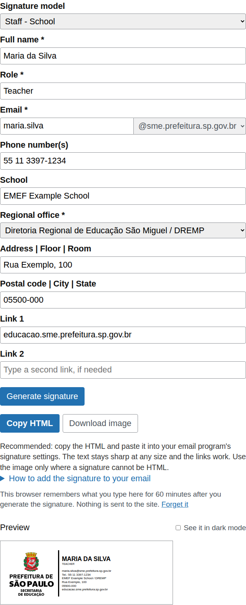
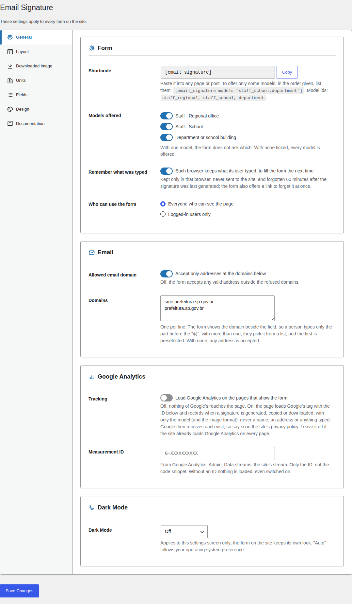
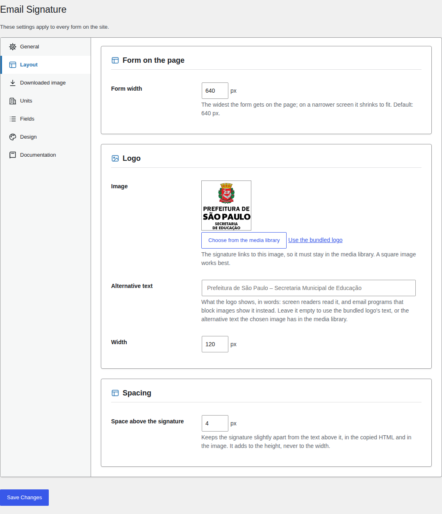
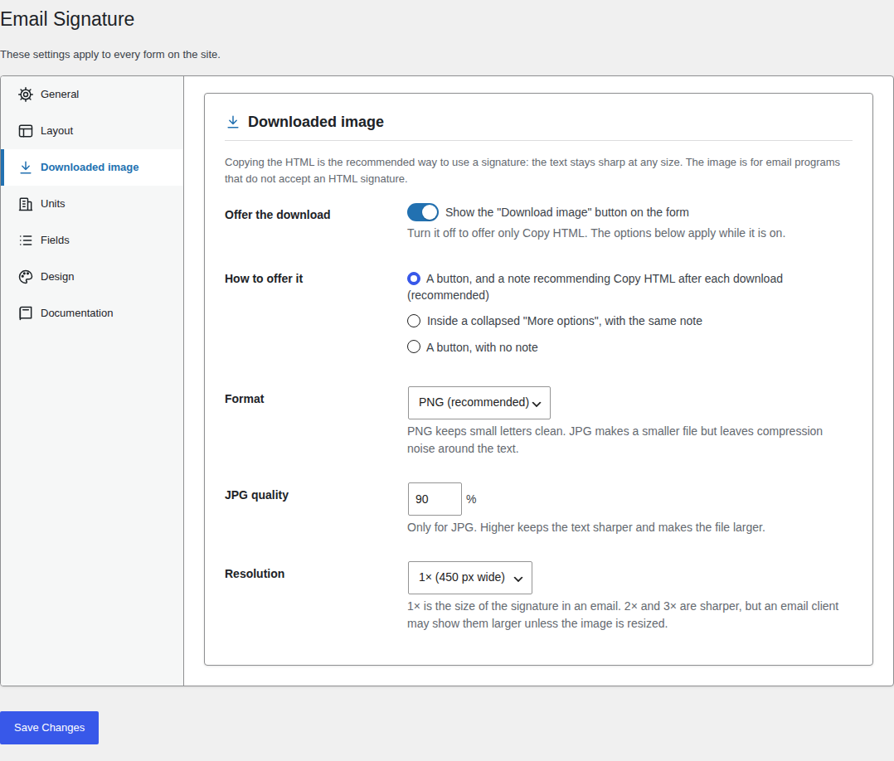
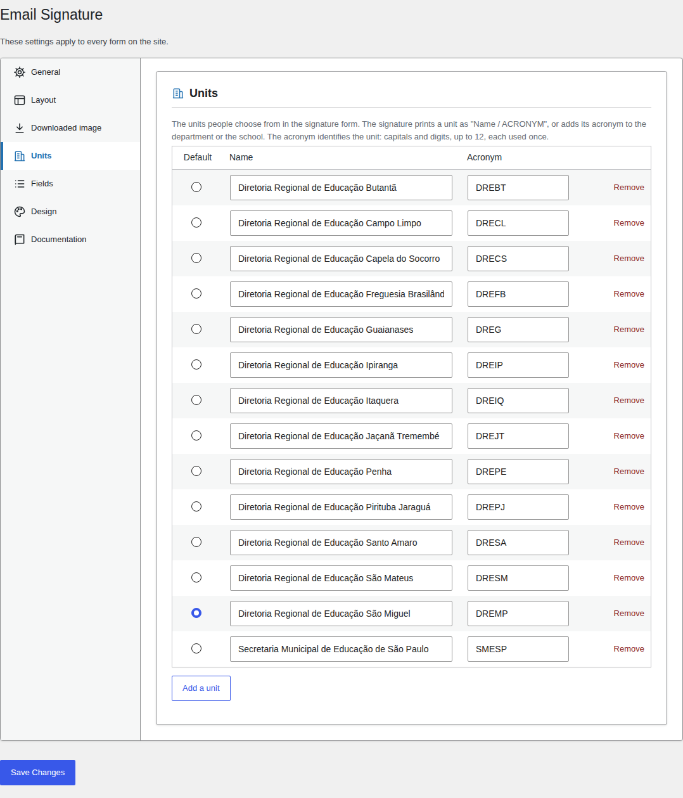
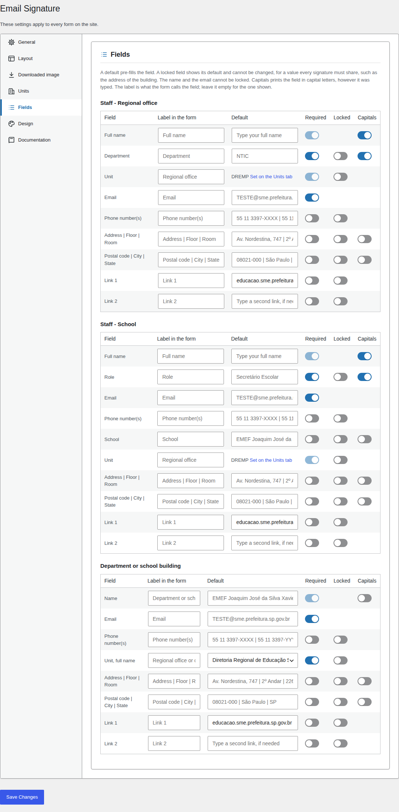
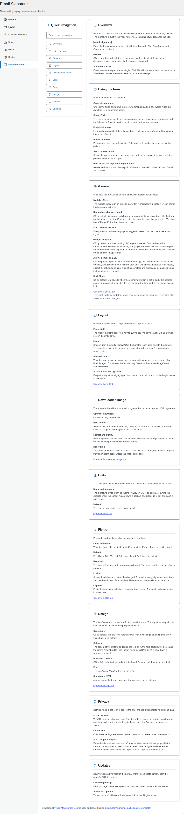

# Email Signature Generator

A form that builds a consistent HTML email signature for everyone in an organisation. Each person picks a model, fills in their details and gets a signature with the same layout, ready to paste into Outlook or to download as an image.

It comes in two forms, both published on every [release](https://github.com/rpgmem/email-signature-generator/releases/latest):

- **WordPress plugin** (`email-signature-generator-X.Y.Z.zip`): place the form on any page with a shortcode. An administrator sets which models are offered, the defaults, the required and locked fields, the allowed or refused email domains and the logo. Updates arrive through the normal WordPress update screen.
- **Standalone HTML** (`email-signature-generator-X.Y.Z.html`): one self-contained file that needs no WordPress. Open it in a browser or publish it on any web page. The latest one is served at **https://rpgmem.github.io/email-signature-generator/**.

The default layout and logo are those of the São Paulo Municipal Department of Education (SME-SP), and both can be adapted to another organisation.

**Requires** WordPress 6.8 or later and PHP 8.3 or later (plugin only) · **License** GPLv3 or later

## Models

- **Staff, regional office:** for people who work at a Regional Education Office (DRE).
- **Staff, school:** for people who work at a school.
- **Department or school building:** for a department of a DRE, or for the school as a whole.

## How to use it

**In WordPress**, put `[email_signature]` on any page. To offer only some models, list them: `[email_signature models="staff_school,department"]` (the ids are `staff_regional`, `staff_school` and `department`).

In **Settings → Email Signature** an administrator sets, for every form on the site:

- **General:** the models offered, who may use the form, whether each browser may remember what was typed, optional Google Analytics (off by default; only a GA4 measurement ID, never a pasted snippet), and the email domains (only some allowed, shown beside the field so people type only the part before the "@", or any address except placeholder domains such as `test.com`), and this screen's Dark Mode (off, on, or following the operating system).
- **Layout:** how wide the form gets on the page, the logo (from the media library), its width and its alternative text, and the space above the signature.
- **Downloaded image:** whether and how the download is offered, and the image's format (PNG or JPG) and resolution.
- **Units:** the units people choose from (name and acronym), and which one the form starts on.
- **Fields:** per field, the label the form shows, a default, and whether it is required, locked or printed in capitals.
- **Design:** off by default; switched on, the form's colours (accent, text on it, borders, notes, errors), rounded corners and font (its own or the theme's). Colour pairs below WCAG's 4.5:1 are saved with a warning. The signature itself keeps its look.
- **Documentation:** what every setting does, how the form behaves, privacy and updates, inside WordPress.

The on/off settings and Dark Mode save the moment they change; the rest saves with **Save Changes**.

**Standalone**, open the `.html` file in a browser, publish it on any web page, or embed the latest one:

```html
<iframe src="https://rpgmem.github.io/email-signature-generator/" style="width:100%;height:1400px;border:0" title="Email signature"></iframe>
```

Then:

1. Choose a model and fill in the fields.
2. Click **Generate signature** to see the preview.
3. Phone numbers are formatted as you leave the field, and each one becomes a link that dials it. **See it in dark mode** shows how the signature looks in an email program's dark theme.
4. Once the signature is generated, click **Copy HTML** and paste it into your email client's signature settings, such as Outlook's or Gmail's. This is the recommended way: the text stays sharp at any size and the links work. **Download image** saves it as a PNG (or a JPG, if the site chose that) for programs that do not accept an HTML signature, where the site offers it. **How to add the signature to your email** explains the steps for Outlook on the web, classic Outlook, Gmail and phones.

## Privacy

The signature is built in the visitor's browser: nothing typed is sent to the site, and the plugin stores no personal data. When the administrator turns on **Remember what was typed** (off by default), the values stay in that browser's local storage so the form fills itself the next time, and they are forgotten 60 minutes after the signature was last generated; the form also has a **Forget it** link that clears them at once. Leave it off where computers are shared.

By default the form sets no cookie and loads no third-party file. If the administrator switches on **Google Analytics** (off by default), the pages with the form load Google's tag, which sets Google's cookies, and record when a signature is generated, copied or downloaded, with only the model and the image format.

## Screenshots

The form, with a signature generated from fictitious details:



The preview in dark mode:


The settings, one tab at a time:

| | |
| --- | --- |
|  **General** |  **Layout** |
|  **Downloaded image** |  **Units** |
|  **Fields** |  **Documentation** |

## Documentation and contributing

- [CHANGELOG.md](CHANGELOG.md): what changed in each release.
- [CLAUDE.md](CLAUDE.md): how the repository is organised, the checks every change goes through and how releases are cut.
